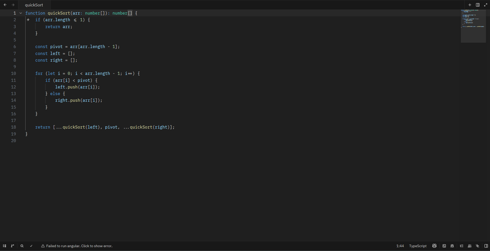
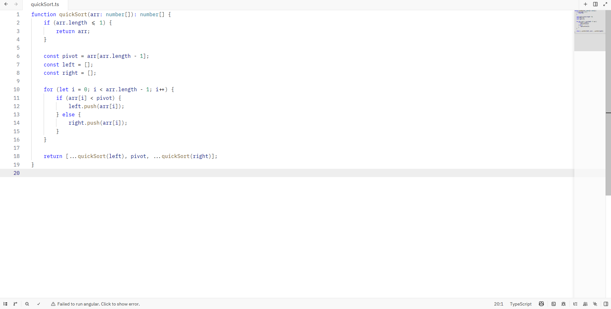

# VS Expresso

A [Zed](https://zed.dev) theme extension that brings the look of Visual Studio Code's **Dark Modern** and **Light Modern** themes to Zed.

## Themes

| Theme | Appearance | Based on |
|---|---|---|
| VS Expresso Dark | Dark | VS Code Dark Modern |
| VS Expresso Light | Light | VS Code Light Modern |

## Screenshots




## Installation

### From the Zed extension registry

1. Open Zed and press `Ctrl+Shift+X` to open the Extensions panel.
2. Search for **VS Expresso** and click **Install**.

### As a dev extension

1. Clone this repository.
2. In Zed, open the command palette and run `zed: install dev extension`.
3. Select the cloned folder.

## Usage

Open the command palette, run `theme selector: toggle`, and pick **VS Expresso Dark** or **VS Expresso Light**.

Or set it in your `settings.json`:

```json
{
  "theme": {
    "mode": "system",
    "light": "VS Expresso Light",
    "dark": "VS Expresso Dark"
  }
}
```

## What's covered

- Editor, gutter, active line, selection and cursor colours
- Sidebar, title bar, status bar, tabs and panels
- Syntax highlighting (keywords, types, functions, strings, comments, numbers and more)
- Git status colours (added, modified, deleted, renamed, conflict)
- Diagnostics (error, warning, info, hint)
- Terminal ANSI colours
- Scrollbar and minimap, indent guides and search highlights
- Bracket accent colours

## Project structure

```
VS-Expresso/
├── extension.toml          # Extension manifest
├── themes/
│   └── vs-expresso.json    # Dark and Light theme definitions
├── LICENSE
└── README.md
```

## Contributing

Issues and pull requests are welcome. If a colour looks off compared with VS Code, please open an issue with a screenshot of both.

## License

[MIT](LICENSE) © 2026 Ajay Ramesh

Colour values are derived from Visual Studio Code's default themes, which are also MIT licensed.
